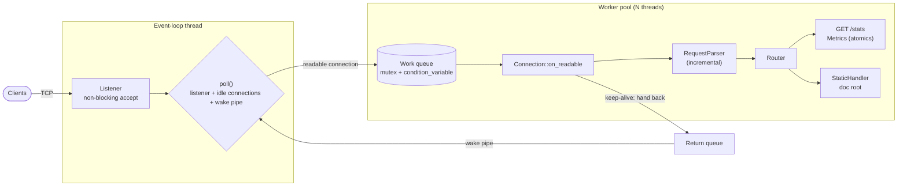

<p align="center">
  <picture>
    <source media="(prefers-color-scheme: dark)" srcset="assets/logo-dark.svg">
    
  </picture>
</p>

<p align="center">
  <a href="https://github.com/depuc8/hearth/actions/workflows/ci.yml"></a>
  <a href="https://codecov.io/gh/depuc8/hearth"></a>
  <a href="LICENSE"></a>
  
</p>

**hearth** is a small, multithreaded HTTP/1.1 server written in C++17 on
nothing but POSIX sockets. A single `poll()` event loop owns the listening
socket and every idle keep-alive connection, and a fixed pool of worker
threads parses and answers requests. That way a thousand idle clients cost
no threads at all. It serves static files safely, keeps connections alive the
way HTTP/1.1 intends, enforces header and body limits, and reports live
metrics from lock-free atomic counters. It has no Boost, no Asio and no
third-party runtime dependencies, just about 2 400 lines you can read in an
afternoon, backed by 151 tests that run clean under AddressSanitizer,
UndefinedBehaviorSanitizer and ThreadSanitizer.

## Features

- **HTTP/1.1 from scratch.** An incremental request parser that is safe to
  feed one byte at a time. It handles request line, headers and
  Content-Length bodies, supports pipelining, and accepts both CRLF and bare
  LF.
- **Thread pool + event loop.** A fixed-size `std::thread` pool behind a
  mutex/condition-variable queue, fed by a `poll()` loop (Linux and macOS).
- **Keep-alive done properly.** Persistent by default on HTTP/1.1, honors
  `Connection: close` and HTTP/1.0 `keep-alive`, with an idle timeout (5 s)
  and a per-connection request cap.
- **Routing.** Exact and prefix routes with clear precedence; 404 vs 405 with
  a correct `Allow` header; HEAD handled automatically for GET routes.
- **Static files.** Correct `Content-Type`/`Content-Length`, `index.html` for
  directories, and two layers of path-traversal defense (`..` rejection, then
  canonicalization plus a containment check that also catches escaping
  symlinks).
- **Limits.** 8 KiB header section, configurable body limit, header count
  limit. Violations get 400 / 413 / 414 / 431 / 501 / 505.
- **Metrics.** `GET /stats` returns active connections, total connections,
  total requests and uptime as JSON, from `std::atomic` counters.
- **Graceful shutdown.** SIGINT/SIGTERM stop accepting, close idle
  connections and let in-flight requests finish.

## Architecture



| Directory | Contents |
| --- | --- |
| `src/net/` | RAII `Socket`, `Listener`, non-blocking I/O helpers, `Connection` (per-client state machine) |
| `src/http/` | Incremental `RequestParser`, `Response` builder, status codes, MIME types, percent-decoding |
| `src/router/` | Method + path routing with exact/prefix matches, 404/405 |
| `src/server/` | `ThreadPool`, `Server` event loop, `Metrics`, CLI parsing, default routes |
| `src/static/` | `StaticHandler` with traversal protection |
| `tests/` | GoogleTest suites: unit, real-socket integration, concurrency |

## Build, run, test

**Requirements:** CMake ≥ 3.21 (for presets; plain `cmake` works from 3.16),
Ninja, and a C++17 compiler. The test suite has been run with GCC 13 and 16
and Clang 18, 21 and 22, and GCC 12 builds the Docker image. The
`asan`/`tsan` presets use Clang. GoogleTest is
downloaded automatically.

```sh
git clone https://github.com/depuc8/hearth.git
cd hearth

cmake --preset release
cmake --build --preset release
ctest --preset release

./build/release/src/hearth --port 8080 --threads 8 --root ./public
# open http://localhost:8080/  ·  curl http://localhost:8080/stats
```

Other presets: `debug`, `asan` (Address + UndefinedBehavior sanitizers),
`tsan` (ThreadSanitizer) and `coverage`. Each one works the same way:

```sh
cmake --preset tsan && cmake --build --preset tsan && ctest --preset tsan
```

### Command line

```
Usage: hearth [options]
  --port <n>             TCP port to listen on, 0 = ephemeral (default 8080)
  --host <addr>          Address to bind (default 0.0.0.0)
  --threads <n>          Worker threads, 0 = one per core (default 0)
  --root <dir>           Document root for static files (default ./public)
  --idle-timeout-ms <n>  Close idle keep-alive connections after n ms (default 5000)
  --max-requests <n>     Requests per connection before closing (default 1000)
  --max-body <bytes>     Largest accepted request body (default 1048576)
  -h, --help / -V, --version
```

### Docker

```sh
docker build -t hearth .
docker run --rm -p 8080:8080 hearth            # serves the bundled demo site
docker run --rm -p 8080:8080 -v "$PWD/site:/srv/public:ro" hearth
```

### Formatting and static analysis

```sh
scripts/lint.sh format-check   # clang-format 23 (pinned in CI)
scripts/lint.sh tidy build/debug
```

## Benchmarks

`scripts/bench.sh` runs `wrk -t4 -c64 -d30s` against `/` and `/style.css` and
writes [`bench/results.md`](bench/results.md) with machine details. The table
below is copied from that file.

**Machine:** 12th Gen Intel Core i5-12500H (16 logical cores), Fedora Linux 44,
kernel 7.2, GCC 16.2, hearth 0.1.0 `--threads 16`, client on the same machine.

**wrk:** *not run. wrk was not installed on the machine that produced these
results*, so this table is a placeholder until `scripts/bench.sh` is run where
wrk is available.

| Target | Requests/sec | Transfer/sec | Avg latency | p99 latency | Errors |
| --- | --- | --- | --- | --- | --- |
| `GET /` (index.html) | _pending_ | _pending_ | _pending_ | _pending_ | _pending_ |
| `GET /style.css` | _pending_ | _pending_ | _pending_ | _pending_ | _pending_ |

**Supplementary: ApacheBench** (`ab -k -c 64 -t 30`, keep-alive). ab is
single-threaded and usually saturates before the server, so treat these as a
lower bound, not as wrk-comparable numbers:

| Target | Requests/sec | Transfer rate | Mean latency | p99 latency | Failed | Non-2xx |
| --- | --- | --- | --- | --- | --- | --- |
| `GET /` | 159626.67 | 358223.92 KB/s | 0.401 ms | 1 ms | 0 | 0 |
| `GET /style.css` | 172643.39 | 355233.17 KB/s | 0.371 ms | 1 ms | 0 | 0 |

## Design notes

### Thread pool vs. thread-per-connection

Thread-per-connection is the simplest model: block in `recv()`, answer,
repeat. But every client costs a thread, with its stack, scheduler pressure
and context switches, even while it does nothing. With HTTP/1.1 keep-alive,
"doing nothing" is most of a connection's life.

A plain thread pool where each pooled task owns a connection until it closes
has the same problem in a different form: with 8 workers, the 9th keep-alive
client waits until someone else's idle timeout expires.

hearth separates *waiting* from *working*. One event-loop thread `poll()`s the
listener and every idle connection. When a connection becomes readable, it
leaves the poll set and goes onto the pool's queue. A worker reads what's
available, feeds the incremental parser, answers every complete request, and
hands the connection back through a mutex-protected return queue plus a
self-pipe wakeup. Idle connections cost one `pollfd` each, and the
`MoreIdleConnectionsThanWorkers` test serves 20 keep-alive clients with 2
workers. Since a connection is only ever owned by one thread at a time (the
handoffs go through mutexes), connection state needs no locking.

### Keep-alive handling

- HTTP/1.1 connections persist unless the client sends `Connection: close`;
  HTTP/1.0 connections persist only with `Connection: keep-alive` (echoed
  back).
- The server closes after the response (with `Connection: close`) when the
  per-connection cap is reached (`--max-requests`), or when it is shutting
  down.
- Idle connections are closed by the event loop after `--idle-timeout-ms`.
  The poll timeout is computed from the earliest deadline, so there's no busy
  polling.
- Pipelined requests already in the buffer are answered in order without
  going back to the event loop. Each wakeup is capped at 16 reads so one
  chatty client can't starve the others.
- Malformed requests get an error response, then a *lingering close*: the
  server half-closes and briefly drains input, so the client actually
  receives the 400/413/431 instead of a TCP reset.

### The atomic counter race

`/stats` counters are incremented by the event loop and every worker
concurrently. With a plain `int`, `++count` is a load, an add and a store, so
two threads can interleave and lose updates. Worse, it's a data race and
therefore undefined behaviour. In a measured `-O3` build the optimizer folded
each thread's loop into a single `+= 100000`, so a failure lost an entire
thread's worth of increments. ThreadSanitizer flags the race on every run.
`std::atomic` with relaxed ordering makes each increment a single indivisible
read-modify-write at essentially no cost. See
[docs/atomic-counter-race.md](docs/atomic-counter-race.md) for the real TSan
report, measurements and a reproducible demo.

More judgment calls are recorded in [DECISIONS.md](DECISIONS.md).

## Limitations

- No TLS, HTTP/2, chunked request bodies (`Transfer-Encoding` → 501) or
  chunked responses.
- Static files are read fully into memory per request: no `sendfile()`,
  range requests, `ETag`/`Last-Modified` or compression.
- Writes block the worker that does them (bounded by a 5 s write timeout).
  An extremely slow reader occupies one worker for that long.
- The idle timeout resets on every byte received, so a "slowloris" client
  trickling header bytes can hold a connection open.
- `poll()` is O(n) in open connections per wakeup. That's fine for thousands
  of connections, not for hundreds of thousands.
- Directory URLs without a trailing slash serve `index.html` directly, with
  no redirect, so relative links in such pages resolve against the parent.

## Roadmap

- epoll (Linux) and kqueue (macOS) backends behind the same interface
- `sendfile()` and range requests for static files; `ETag`/`If-None-Match`
- Per-request header deadline (slowloris protection) and a max-connections cap
- Non-blocking writes buffered in the event loop
- Chunked transfer encoding (request and response)
- Access logging with a lock-free ring buffer
- Run `scripts/bench.sh` with wrk and track results over time

## License

[MIT](LICENSE). Contributions welcome: see [CONTRIBUTING.md](CONTRIBUTING.md).
